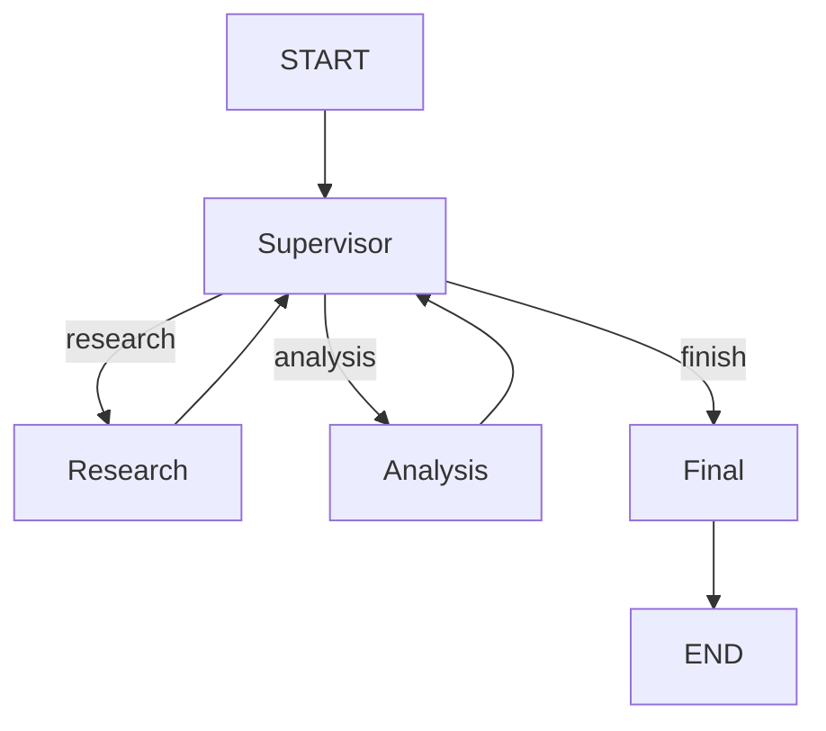

# Multi-agent incident research orchestrator

A LangGraph prototype that routes an incident question through a research specialist, an analysis specialist, and a validating supervisor. The included corpus and offline demo make the full delegation flow reproducible without API credits. In live mode, the supervisor uses an OpenAI model to choose the next node; specialist tools remain scoped to local evidence and arithmetic.

## Quick start (Python 3.12+)

```powershell
py -3.12 -m venv .venv
.\.venv\Scripts\Activate.ps1
pip install -r requirements.txt
python main.py --offline
python -m unittest discover -s tests -v
```

If `py -3.12` is unavailable but [uv](https://docs.astral.sh/uv/) is installed, use `uv venv --python 3.12 .venv` followed by `uv pip install --python .venv/Scripts/python.exe -r requirements.txt`.

For a model-driven supervisor, copy `.env.example` to `.env`, put your own `OPENAI_API_KEY` there, and run `python main.py --query "Investigate INC-104 and calculate the p95 latency increase"`. Never commit `.env`. The example trace and notebook use the **offline demo supervisor**, not a live OpenAI execution.

## Graph



`state.py` extends `MessagesState` with reports, calculation, `contributions`, `decisions`, the next route, and a supervisor-step count. `contributions` and `decisions` use append reducers, so each specialist's work and each routing decision remain visible. Each specialist reads only the query or reports it needs; the live supervisor receives bounded excerpts rather than the full chat history. The graph invokes all nodes asynchronously.

The research specialist calls `search_reports`, which indexes `data/*.md` into a local SQLite FTS5 database and queries it with parameterized SQL. The analysis specialist extracts documented p95 measurements and calls `calculate_percent_change`. The supervisor chooses a route using a structured `Literal` decision and a completion rubric. The graph rejects premature completion without evidence or calculation, clears stale analysis when research runs again, and stops after five supervisor visits. If measurements conflict or cannot be verified, it returns an explicit uncertainty instead of inventing a number.

## Demo and verification

Open [demo.ipynb](demo.ipynb) and run its cells, or run `python main.py --offline`. The output shows `Supervisor → Research → Supervisor → Analysis → Supervisor → Final`, a 50.0% increase for `INC-104`, and a source citation. `python main.py --offline --query "Investigate INC-999"` demonstrates the bounded unknown-source path. Tests cover delegation, premature-finish correction, refinement, step limit, and graph topology.

This is a local SQLite full-text index, **not** live web search or the Pinecone index from a previous checkpoint. It requires no separate search credentials. The notebook is the requested delegation demo. No live API call is part of the checked-in evidence.
